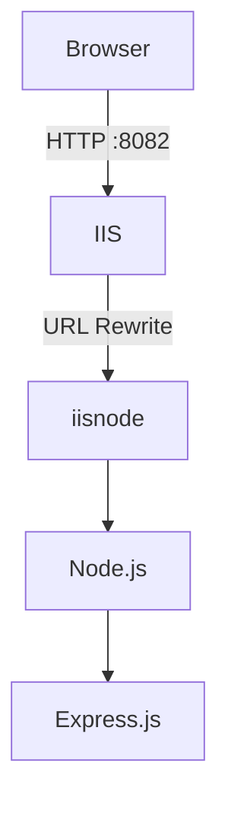
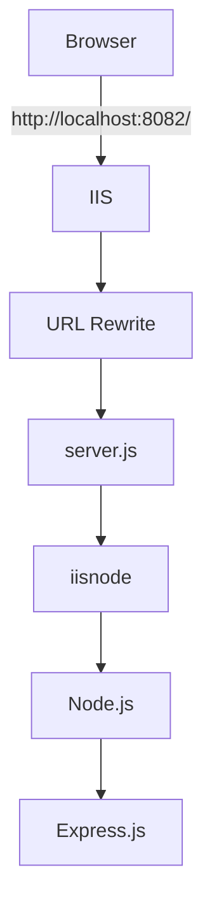

# Node.js Express Application on IIS with iisnode

This guide explains how to deploy a Node.js/Express application on **Microsoft IIS** using **iisnode** and **IIS URL Rewrite**.

The setup uses:

- Windows
- IIS
- IISNode
- IIS URL Rewrite
- Node.js
- Express.js
- `web.config`

## Architecture



IIS handles the incoming HTTP request, URL Rewrite forwards the request to `server.js`, and iisnode runs the Node.js application.

---

# Prerequisites

Before deploying the application, install the following:

## 1. Node.js

Install Node.js on the Windows server.

Verify:

```cmd
node --version
npm --version
```

If using pnpm:

```cmd
pnpm --version
```

The Node.js installation must be available to the IIS environment.

Check the Node.js location:

```cmd
where node
```

Example:

```text
C:\Program Files\nodejs\node.exe
```

---

## 2. IIS

Enable IIS and the required IIS components.

At minimum, the following should be available:

- IIS Web Server
- IIS Management Console
- Static Content
- Default Document
- HTTP Errors
- Request Filtering

You can verify IIS is working by opening:

```text
http://localhost
```

---

## 3. IIS URL Rewrite

Install the **IIS URL Rewrite Module** from the [Microsoft Download Center](https://www.microsoft.com/en-us/download/details.aspx?id=57470) or the [IIS URL Rewrite page](https://www.iis.net/downloads/microsoft/url-rewrite).

URL Rewrite is required because the application uses `web.config` to redirect incoming requests to `server.js`.

After installation, verify that URL Rewrite is available in IIS Manager.

The application uses:

```xml
<rewrite>
    <rules>
        ...
    </rules>
</rewrite>
```

---

## 4. IISNode

Install **iisnode** from the [iisnode GitHub releases](https://github.com/tjanchev/iisnode-core/releases) or via [Web Platform Installer](https://www.microsoft.com/web/downloads/platform.aspx). The MSI installer is the most common option.

The installation should provide:

```text
C:\Program Files\iisnode\iisnode.dll
```

Verify:

```cmd
dir "%ProgramFiles%\iisnode"
```

You should see:

```text
iisnode.dll
```

Verify that IIS has the module registered:

```cmd
%windir%\system32\inetsrv\appcmd.exe list modules | findstr /I iisnode
```

Expected:

```text
MODULE "iisnode" ( native, preCondition: )
```

You can also verify the global module registration:

```cmd
%windir%\system32\inetsrv\appcmd.exe list config /section:system.webServer/globalModules | findstr /I iisnode
```

Expected:

```text
<add name="iisnode" image="%programfiles%\iisnode\iisnode.dll" />
```

---

# Project Structure

The application can use a structure similar to:

```text
iis-node-app/
├── node_modules/
├── package.json
├── pnpm-lock.yaml
├── server.js
└── web.config
```

Example `server.js`:

```js
const express = require("express");

const app = express();

app.get("/", (req, res) => {
  res.send("Express is working on IISNode!");
});

app.listen(process.env.PORT);
```

Do not hardcode the IIS port in the application.

Use:

```js
process.env.PORT;
```

iisnode provides the port to the Node.js process.

---

# web.config

Create a `web.config` in the application root:

```xml
<configuration>
    <system.webServer>

        <handlers>
            <add
                name="iisnode"
                path="server.js"
                verb="*"
                modules="iisnode"
            />
        </handlers>

        <rewrite>
            <rules>
                <rule name="sendToNode" stopProcessing="true">
                    <match url=".*" />
                    <action type="Rewrite" url="server.js" />
                </rule>
            </rules>
        </rewrite>

        <iisnode
            devErrorsEnabled="true"
            loggingEnabled="true"
            logDirectory="iisnode"
        />

    </system.webServer>
</configuration>
```

Important:

- `server.js` must exist in the application root.
- `iisnode` must be installed and registered.
- URL Rewrite must be installed.
- The `handlers` and `rewrite` sections must be allowed at the application level.

---

# IIS Configuration

## 1. Create the Application Directory

For example:

```text
C:\inetpub\iis-node-app
```

Copy the application into the directory:

```cmd
xcopy "C:\path\to\iis-node-app" "C:\inetpub\iis-node-app" /E /I
```

Or copy the files using Explorer.

---

## 2. Install Dependencies

Open Command Prompt:

```cmd
cd /d C:\inetpub\iis-node-app
```

Using npm:

```cmd
npm install
```

Using pnpm:

```cmd
pnpm install
```

For production deployments, prefer:

```cmd
pnpm install --prod
```

if the application does not require development dependencies at runtime.

---

## 3. Create the iisnode Log Directory

Create:

```cmd
mkdir C:\inetpub\iis-node-app\iisnode
```

iisnode can use this directory to store Node.js stdout/stderr logs.

---

## 4. Configure IIS Permissions

The IIS application pool needs permission to access the application.

For a simple deployment, grant IIS users Modify permission:

```cmd
gsudo icacls "C:\inetpub\iis-node-app" /grant "IIS_IUSRS:(OI)(CI)(M)" /T
```

Explanation:

```text
IIS_IUSRS  = IIS worker process group
(OI)       = Object Inherit
(CI)       = Container Inherit
(M)        = Modify
/T         = Apply recursively
```

`Modify` is required because iisnode may need to create log files.

If the application only requires read access and logging is disabled, more restrictive permissions can be used.

---

## 5. Create an IIS Site

Open:

```text
IIS Manager
```

Go to:

```text
Sites
```

Create a new site.

Example:

```text
Site name:
iis-node-app

Physical path:
C:\inetpub\iis-node-app

Binding:
http

IP address:
All Unassigned

Port:
8082
```

The application will then be available at:

```text
http://localhost:8082/
```

---

## 6. Configure the Application Pool

For a Node.js/iisnode application, use:

```text
.NET CLR Version:
No Managed Code

Managed Pipeline Mode:
Integrated
```

The application pool should be running.

A typical configuration:

```text
Application Pool
├── .NET CLR Version: No Managed Code
├── Managed Pipeline: Integrated
└── Identity: ApplicationPoolIdentity
```

---

# Unlock IIS Configuration Sections

If IIS reports:

```text
HTTP Error 500.19
0x80070021
```

with:

```text
This configuration section cannot be used at this path.
```

the relevant IIS configuration section is locked.

Unlock the handlers section:

```cmd
gsudo %windir%\system32\inetsrv\appcmd.exe unlock config /section:system.webServer/handlers
```

Unlock URL Rewrite rules:

```cmd
gsudo %windir%\system32\inetsrv\appcmd.exe unlock config /section:system.webServer/rewrite/rules
```

Successful output:

```text
Unlocked section "system.webServer/handlers"
Unlocked section "system.webServer/rewrite/rules"
```

Restart IIS:

```cmd
gsudo iisreset
```

---

# Deploying Updates

When deploying a new version:

## 1. Stop the IIS site or application pool

In IIS Manager, stop the application pool if necessary.

Or:

```cmd
%windir%\system32\inetsrv\appcmd.exe stop apppool "iis-node-app"
```

## 2. Update the application

Copy the new source files into:

```text
C:\inetpub\iis-node-app
```

Do not overwrite configuration accidentally if you have environment-specific settings.

## 3. Install/update dependencies

```cmd
cd /d C:\inetpub\iis-node-app
pnpm install --prod
```

or:

```cmd
npm install --omit=dev
```

## 4. Start the application pool

```cmd
%windir%\system32\inetsrv\appcmd.exe start apppool "iis-node-app"
```

iisnode will start the Node.js process when IIS receives a request.

---

# Testing the Node.js Application

Before troubleshooting IIS, test Node.js directly.

From the application directory:

```cmd
cd /d C:\inetpub\iis-node-app
```

Set a temporary port:

```cmd
set PORT=3000
```

Start the application:

```cmd
node server.js
```

Then from another terminal:

```cmd
curl http://localhost:3000/
```

Expected:

```text
Express is working on IISNode!
```

Stop the application with:

```text
Ctrl+C
```

This confirms that Node.js and Express work independently of IIS.

---

# Troubleshooting

## HTTP 500.19 - 0x80070005

Example:

```text
Cannot read configuration file due to insufficient permissions
```

Cause:

IIS cannot read the application's `web.config` or traverse the application directory.

Check:

```cmd
icacls "C:\inetpub\iis-node-app"
```

Check:

```cmd
icacls "C:\inetpub\iis-node-app\web.config"
```

Grant IIS access if necessary:

```cmd
gsudo icacls "C:\inetpub\iis-node-app" /grant "IIS_IUSRS:(OI)(CI)(M)" /T
```

---

## HTTP 500.19 - 0x80070021

Example:

```text
This configuration section cannot be used at this path.
```

Cause:

The IIS configuration section is locked at a parent level.

Unlock:

```cmd
gsudo %windir%\system32\inetsrv\appcmd.exe unlock config /section:system.webServer/handlers
```

```cmd
gsudo %windir%\system32\inetsrv\appcmd.exe unlock config /section:system.webServer/rewrite/rules
```

Restart:

```cmd
gsudo iisreset
```

---

## iisnode 500.1002 / HRESULT 0x2

Example:

```text
iisnode encountered an error when processing the request.

HRESULT: 0x2
HTTP status: 500
HTTP subStatus: 1002
```

Check:

```text
server.js
```

exists:

```cmd
dir C:\inetpub\iis-node-app\server.js
```

Check:

```text
node_modules
```

exists:

```cmd
dir C:\inetpub\iis-node-app\node_modules
```

Check Node.js:

```cmd
node --version
```

Check iisnode logs:

```cmd
dir C:\inetpub\iis-node-app\iisnode
```

Make sure IIS can write to the directory:

```cmd
gsudo icacls "C:\inetpub\iis-node-app" /grant "IIS_IUSRS:(OI)(CI)(M)" /T
```

---

# Checking IISNode Registration

Check the IIS module:

```cmd
%windir%\system32\inetsrv\appcmd.exe list modules | findstr /I iisnode
```

Expected:

```text
MODULE "iisnode" ( native, preCondition: )
```

Check the global module:

```cmd
%windir%\system32\inetsrv\appcmd.exe list config /section:system.webServer/globalModules | findstr /I iisnode
```

Expected:

```text
<add name="iisnode" image="%programfiles%\iisnode\iisnode.dll" />
```

---

# Checking URL Rewrite

Open IIS Manager and verify that the **URL Rewrite** feature is installed.

The application requires:

```xml
<rewrite>
    <rules>
        ...
    </rules>
</rewrite>
```

If URL Rewrite is not installed, the `web.config` rewrite configuration will not work.

---

# Checking the IIS Application Pool

Verify the application pool:

```cmd
%windir%\system32\inetsrv\appcmd.exe list apppool
```

Check a specific pool:

```cmd
%windir%\system32\inetsrv\appcmd.exe list apppool "iis-node-app"
```

If stopped:

```cmd
%windir%\system32\inetsrv\appcmd.exe start apppool "iis-node-app"
```

---

# Useful IIS Commands

List websites:

```cmd
%windir%\system32\inetsrv\appcmd.exe list site
```

List application pools:

```cmd
%windir%\system32\inetsrv\appcmd.exe list apppool
```

Restart IIS:

```cmd
gsudo iisreset
```

Stop an application pool:

```cmd
%windir%\system32\inetsrv\appcmd.exe stop apppool "iis-node-app"
```

Start an application pool:

```cmd
%windir%\system32\inetsrv\appcmd.exe start apppool "iis-node-app"
```

---

# Production Recommendations

For production deployments:

- Use a dedicated IIS site.
- Use a dedicated application pool.
- Use `No Managed Code`.
- Use `ApplicationPoolIdentity`.
- Keep the application outside user profile directories such as `Desktop`.
- Use `C:\inetpub\...` or another dedicated application directory.
- Grant the IIS application only the permissions it needs.
- Avoid running the application as Administrator.
- Disable `devErrorsEnabled` in production.
- Configure proper application logging.
- Use HTTPS with an IIS certificate.
- Keep Node.js and dependencies updated where compatible with the iisnode version.
- Test Node.js/iisnode compatibility before upgrading Node.js.
- Do not expose development error pages publicly.

For production, change:

```xml
<iisnode
    devErrorsEnabled="true"
    loggingEnabled="true"
    logDirectory="iisnode"
/>
```

to:

```xml
<iisnode
    devErrorsEnabled="false"
    loggingEnabled="true"
    logDirectory="iisnode"
/>
```

---

# Quick Deployment Checklist

---

## Summary of Steps

1. **[Prerequisites](#prerequisites)** — Install Node.js, IIS, IIS URL Rewrite, and iisnode.
2. **[Project Structure](#project-structure)** — Create `package.json`, `server.js`, and `web.config`.
3. **[IIS Configuration](#iis-configuration)** — Copy the app to `C:\inetpub\iis-node-app`, install dependencies, create the iisnode log directory, and grant IIS permissions.
4. **[IIS Site](#5-create-an-iis-site)** — Create the site and configure the application pool (No Managed Code, Integrated, ApplicationPoolIdentity).
5. **[Unlock Configuration](#unlock-iis-configuration-sections)** — Unlock the handlers and rewrite sections if needed.
6. **[Testing](#testing-the-nodejs-application)** — Verify Node.js runs directly, then test via IIS.
7. **[Troubleshooting](#troubleshooting)** — Refer to the troubleshooting section for common errors.

# Example Final Setup

```text
C:\inetpub\iis-node-app
│
├── node_modules
│
├── iisnode
│   └── application logs
│
├── package.json
├── pnpm-lock.yaml
├── server.js
└── web.config
```

IIS:

```text
Site
└── iis-node-app
    ├── Binding: http://localhost:8082
    ├── Physical Path: C:\inetpub\iis-node-app
    └── Application Pool
        ├── No Managed Code
        ├── Integrated
        └── ApplicationPoolIdentity
```

Request flow:



Expected response:

```text
Express is working on IISNode!
```
